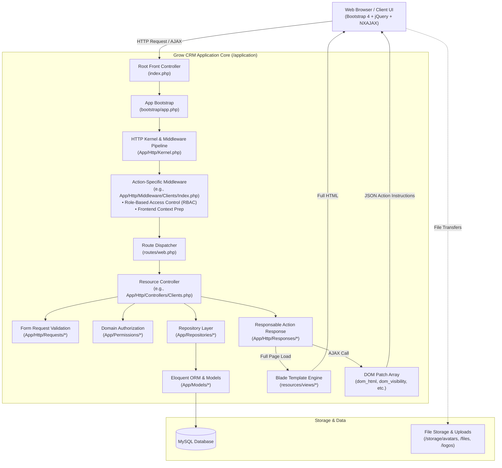
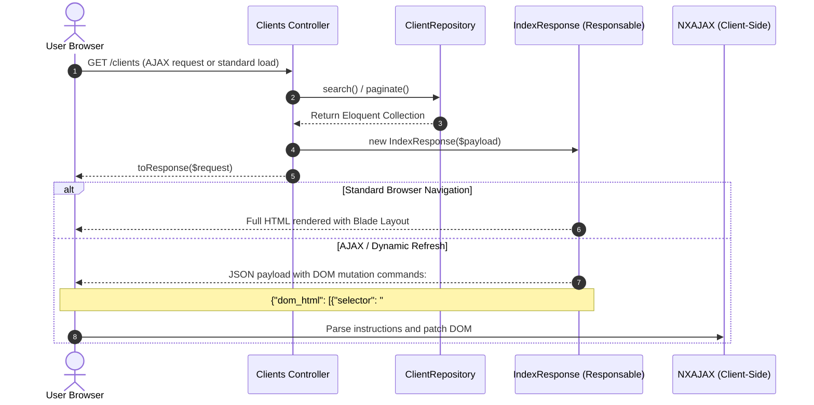

# Grow CRM — System Architecture Documentation


---

## 1. Executive Overview

**Grow CRM** is built on top of the **Laravel 8 (PHP >= 7.2)** framework, utilizing an extended **Action-Domain-Responder (ADR)** pattern alongside a **Repository Pattern** and a proprietary **Declarative JSON-to-DOM AJAX Engine (`NXAJAX`)**.

Instead of conventional full-page reloads or standard Single-Page Application (SPA) frameworks (like Vue or React), Grow CRM uses a **Hypermedia / Server-Driven UI (SDUI)** approach:
- Blade views render standard HTML on direct entry points.
- Asynchronous client-side interactions submit AJAX requests via `data-*` HTML attributes.
- The server responds with structured JSON payload instructions (`dom_html`, `dom_attributes`, `dom_visibility`, `dom_move_element`, etc.).
- The client-side `ajax.js` engine executes these commands directly on the browser DOM without destroying page state.

---

## 2. High-Level Architecture Diagram



---

## 3. Directory Structure and Physical Layout

The repository employs a split-root structure for enhanced shared hosting compatibility and custom base directory binding:

```
GROWCRM/
├── index.php                      # Root entry point & sanity check runner
├── setup.sql                      # Initial DB schema bootstrap
├── .htaccess                      # Root web server URL rewrites
│
├── application/                   # Core Laravel application
│   ├── app/
│   │   ├── Console/              # Artisan CLI kernel
│   │   ├── Cronjobs/             # Scheduled tasks (Email, Invoices, Overdue)
│   │   ├── Exceptions/           # Custom exception handler
│   │   ├── Exports/ & Imports/   # Excel/CSV import and export handlers
│   │   ├── Helpers.php           # Global utility functions
│   │   ├── Http/
│   │   │   ├── Controllers/      # Thin controllers (orchestrators)
│   │   │   ├── Middleware/       # Action-segregated authorization middleware
│   │   │   ├── Requests/         # Form validation rules per resource action
│   │   │   └── Responses/        # Responsable classes returning DOM JSON/views
│   │   ├── Mail/                 # Mailable notifications
│   │   ├── Models/               # Eloquent Models & relationships
│   │   ├── Permissions/          # Object-level permission evaluators
│   │   └── Repositories/         # Data access & query composition layer
│   ├── bootstrap/                # Framework initialization & BASE_DIR definition
│   ├── config/                   # Configuration files (database, auth, mail, etc.)
│   ├── database/                 # Migrations, seeds, factories
│   ├── Modules/                  # Modular extension packages (e.g. DesignSpecification)
│   ├── resources/views/          # Blade view templates & components
│   ├── routes/web.php            # Primary application route definitions
│   └── updating/                 # Incremental schema & feature migration scripts
│
├── public/                        # Publicly accessible web assets
│   ├── boot/                     # Bootstrapping checks (growcrm.php)
│   ├── css/ & scss/              # Compiled CSS and Sass stylesheets
│   ├── js/
│   │   └── core/
│   │       ├── ajax.js           # NXAJAX engine (interprets server DOM instructions)
│   │       ├── app.js            # Core UI bindings, modals, tooltips
│   │       └── billing.js        # Invoicing, payments, and billing interactions
│   └── vendor/                   # Third-party JS/CSS plugins
│
├── storage/                       # User-uploaded files and system cache
│   ├── avatars/                  # User profile pictures
│   ├── files/                    # Project attachments and client documents
│   ├── logos/                    # Tenant/System logos
│   └── temp/                     # Temporary processing directory
│
└── updates/                       # Self-updater archives and packages
```

---

## 4. Key Architectural Patterns & Lifecycles

### 4.1 Granular Action-Specific Middleware Pipeline
Unlike traditional applications that bind generic middleware (e.g., `auth`, `admin`) to entire controllers, Grow CRM uses **granular per-action middleware**:

- `App\Http\Middleware\Clients\Index`
- `App\Http\Middleware\Clients\Create`
- `App\Http\Middleware\Clients\Edit`
- `App\Http\Middleware\Clients\Destroy`

Each middleware:
1. **Verifies granular permissions**: Checks both role permissions (`auth()->user()->role->role_clients`) and contextual ownership (`auth()->user()->clientid == $id`).
2. **Prepares frontend states**: Injects pre-calculated parameters into the request object (e.g., resource types, tab wrappers, breadcrumb actions).
3. **Aborts early**: Returns HTTP 403 / standard error payload before reaching business logic if access is unauthorized.

---

### 4.2 Action-Domain-Responder (ADR) & Responsable Classes

Controllers in Grow CRM do not render views directly. Instead, they delegate to dedicated **Response classes** implementing Laravel's `Illuminate\Contracts\Support\Responsable`:



#### JSON DOM Protocol Commands
When responding to an AJAX call, the backend returns a structured instruction set interpreted by `public/js/core/ajax.js`:
- `dom_html`: Replaces, prepends, or appends HTML strings to specified CSS selectors.
- `dom_visibility`: Toggles visibility (`show` / `hide` / `slideDown`) of target selectors.
- `dom_attributes`: Modifies element attributes (e.g., updating `data-url` on load-more buttons).
- `dom_classes`: Adds or removes CSS classes.
- `dom_state`: Modifies form control states (`reset`, `disable`, `clear`).
- `notification`: Triggers client toast notifications (via Noty.js).

---

### 4.3 Repository Pattern
Data queries are isolated inside `App\Repositories`:
- Decouples controllers from direct database query logic.
- Standardizes dynamic filtering, search terms, sorting, custom fields, and join logic across web, API, and background processes.
- Example: `ClientRepository::search()` automatically applies role-based visibility filters (e.g., team members only see assigned clients).

---

### 4.4 Authorization & Permissions Layer
Authorization is handled in a two-tier approach:
1. **Tier 1 — Role-Based Access Control (RBAC)**:
   - User roles determine global module permissions (`role_projects`, `role_tasks`, `role_invoices`, `role_manage_clients`).
2. **Tier 2 — Contextual Object Permissions (`App\Permissions\`)**:
   - Evaluated dynamically per entity instance (`ProjectPermissions.php`, `TaskPermissions.php`).
   - Checks project membership, assigned project manager privileges, client ownership, or task assignee status.

---

### 4.5 Automation & Cronjob Subsystem
Scheduled operations are managed through `App\Console\Kernel` and executed via dedicated cron handlers in `App\Cronjobs`:
- **`EmailCron` & `EmailBillsCron`**: Asynchronous batch email dispatch from the `email_queue` table.
- **`RecurringInvoicesCron` & `RecurringTasksCron`**: Automatic generation of recurrent financial and operational records.
- **`OverdueInvoicesCron` & `TaskOverdueCron`**: Deadline monitoring, automated status transitions, and reminder dispatch.
- **`Stripe/`**: Webhook reconciliation and recurring subscription charges.

---

## 5. Security & Data Protection Architecture

- **Input Sanitization**: Request bodies pass through HTML Purifier (`mews/purifier`) and custom sanitizers in `Helpers.php`.
- **Validation**: Strict Form Request validations (`App\Http\Requests\*`) enforce data integrity before hitting repositories.
- **CSRF Protection**: Native Laravel CSRF tokens validated on all mutation requests (`POST`, `PUT`, `DELETE`).
- **File Upload Safeguards**: Multi-layer MIME validation, extension whitelisting, and isolated storage outside public web roots for sensitive contracts and billable documents.

---

## 6. How to Add a New Feature (Developer Workflow)

When extending Grow CRM, follow this architectural pattern:

1. **Route (`routes/web.php`)**:
   Define the route and apply action-specific middleware:
   ```php
   Route::get('/leads', 'Leads@index')->middleware(['leadsMiddlewareIndex']);
   ```
2. **Middleware (`app/Http/Middleware/Leads/Index.php`)**:
   Perform permission checks (`auth()->user()->role->role_leads`) and set UI flags.
3. **Form Request (`app/Http/Requests/Leads/StoreValidation.php`)**:
   Define input validation rules.
4. **Repository (`app/Repositories/LeadRepository.php`)**:
   Create query methods (`get()`, `search()`).
5. **Controller (`app/Http/Controllers/Leads.php`)**:
   Inject the repository and delegate the result to a Response class.
6. **Response (`app/Http/Responses/Leads/IndexResponse.php`)**:
   Return full Blade view or AJAX DOM patch array based on `request()->ajax()`.
7. **Blade Views (`resources/views/pages/leads/`)**:
   Construct modular table, card, and modal views.

