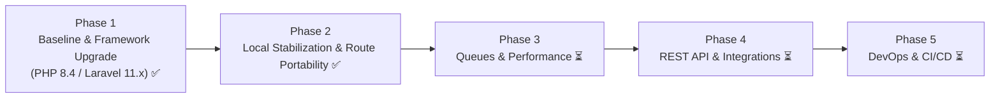

# Grow CRM — Strategic Development & Maintenance Plan

This document outlines the strategic roadmap, technical debt remediation, and modernization plan for **Grow CRM (v1.11)**.

---

## 1. Executive Summary

Grow CRM has a well-designed architecture featuring an Action-Domain-Responder (ADR) flow, repository pattern, and a custom declarative DOM AJAX engine (`NXAJAX`). 

Through recent modernization efforts, the core framework has been successfully upgraded to **Laravel 11.57.0** on **PHP 8.4.0**, and the entire localhost deployment and routing under subfolder environments (`/GROWCRM`) has been stabilized. Future maintenance focuses on automated queue workers, standardizing schema migrations, test coverage, and exposing a REST API.

### Core Objectives
1. **Security & Stability**: Modernize underlying framework dependencies to supported LTS versions *(Achieved: Laravel 11.57 on PHP 8.4)*.
2. **Local & Subdirectory Ergonomics**: Ensure seamless execution under any root or subfolder installation without hardcoded route conflicts *(Achieved)*.
3. **Performance**: Move from synchronous cron execution to true asynchronous queued workers.
4. **Maintainability**: Transition legacy schema scripts into standard Laravel migrations and establish test suites.
5. **Extensibility**: Build a standardized REST API (via Laravel Sanctum) to enable third-party integrations and headless clients.

---

## 2. Current State vs. Target State

| Dimension | Current State (v1.11 Upgraded) | Target State (Modernized) | Status |
| :--- | :--- | :--- | :---: |
| **PHP Runtime** | PHP 8.4.0 (Compatible >= 8.2) | PHP 8.2 – 8.4 | ✅ Completed |
| **Framework** | Laravel 11.57.0 | Laravel 11.x (Latest Active) | ✅ Completed |
| **Routing & Subdirectory** | `_url()` helper + auto-prefixed `NXAJAX` | Relative / Portable Routing | ✅ Completed |
| **Settings Engine** | Clean AJAX + dynamic route pushState | Single-Page Dynamic Settings | ✅ Completed |
| **Local Cron / Scheduler** | `php artisan schedule:run` / `work` | Continuous Queue Workers | 🟡 Operational |
| **Asset Pipeline** | Webpack Mix (Legacy) | Vite 5.x | ⏳ Planned |
| **Queue / Background** | Synchronous cron calls in scheduler | Asynchronous Queues (Redis / DB) | ⏳ Planned |
| **Migrations** | Static `setup.sql` + `DatabaseSeeder.php` | Versioned Laravel Migrations | ⏳ Planned |
| **API Authentication** | Basic API routes | Laravel Sanctum / Token-based REST API | ⏳ Planned |
| **Deployment / Env** | Manual / XAMPP Apache | Dockerized containers + CI/CD | ⏳ Planned |

---

## 3. Phased Implementation Roadmap

---

### Phase 1: Framework Upgrade to Laravel 11.x (Completed ✅)

- [x] **PHP 8.2 – 8.4 Compatibility Verification**:
  - Validated runtime on PHP 8.4.0.
  - Resolved PHP 8.4 system pre-checks in `public/boot/growcrm.php`.
  - Fixed `ConfigThemeServiceProvider.php` for PHP 8.x `array_walk` signature.
  - Added `_count()` null-safe helper in `application/app/Helpers.php` resolving PHP 8 TypeError crashes in Kanban and Tabs views.
- [x] **Framework Upgrade to Laravel 11.x**:
  - Upgraded core dependencies to `laravel/framework: 11.57.0`.
  - Replaced deprecated `fideloper/proxy` with Laravel core's native `TrustProxies`.
  - Replaced abandoned `facade/ignition` with `spatie/laravel-ignition` (v2.12).
  - Replaced abandoned `fzaninotto/faker` with `fakerphp/faker` (v1.24).
  - Upgraded `nwidart/laravel-modules` to v11.1 and modernized commands in `config/modules.php`.
  - Upgraded `barryvdh/laravel-dompdf` to v3.1 and `barryvdh/laravel-debugbar` to v3.16.
  - Verified and cleared all 815 application routes cleanly.

---

### Phase 2: Localhost & Subfolder Stabilization (Completed ✅)

- [x] **Subdirectory URL & Asset Portability**:
  - Fixed asset 404s by normalizing `<base href>` with a trailing slash in layout headers (`header.blade.php`, `header-lite.blade.php`).
  - Replaced hardcoded root links (`href="/..."`) with dynamic `{{ _url('/...') }}` across top navigation, sidebars, and 22+ table/card views.
  - Updated `public/js/core/ajax.js` and `events.js` to ensure all root-relative `data-url` and redirect targets automatically prepend `NX.site_url`.
- [x] **Database Seeding & Test Data**:
  - Populated comprehensive test records via `DatabaseSeeder.php` (clients, contacts, projects, tasks, leads, invoices, line items).
- [x] **Settings Architecture & Navigation Unblocking**:
  - Fixed settings dynamic pushState URL accumulation in `public/js/core/events.js`.
  - Removed duplicate DOM IDs in `leftmenu-settings.blade.php`.
  - Added fallback middleware redirect in `App\Http\Middleware\Settings\Index` ensuring direct browser GET requests to `/settings/*` render the full settings layout with sidebar.
  - Converted update check buttons to smooth AJAX requests so sidebar navigation is never blocked.
  - Verified `Product Purchase Code` is optional and does not impede local configuration.
- [x] **Local Task Scheduler / Cron Verification**:
  - Verified `php artisan schedule:run` executes all 17 registered background tasks successfully.
  - Documented local continuous execution via `php artisan schedule:work` and Windows Task Scheduler.

---

### Phase 3: Background Queues & Performance Optimization (Next Up ⏳)

- [ ] **Queue Worker Migration**:
  - Convert `App\Cronjobs\EmailCron` and `EmailBillsCron` from synchronous scheduler calls into queued jobs dispatched via `Queue::push()`.
  - Configure database queue driver (`php artisan queue:work`) or Redis for high-throughput email and PDF generation.
- [ ] **Database Schema Standardization**:
  - Convert `setup.sql` table structures into versioned Laravel migration files (`database/migrations/`).
  - Package legacy `application/updating/updating_*.php` into discrete database migrations.
- [ ] **Database Indexing & Query Tuning**:
  - Audit high-volume query joins in `App\Repositories\TaskRepository` and `ProjectRepository`.
  - Add composite indexes on `events` (`event_parent_type`, `event_parent_id`, `created_at`) and `tasks` (`task_projectid`, `task_status`).
- [ ] **Asset Bundling Modernization**:
  - Migrate from `webpack.mix.js` to modern Vite 5.x.
  - Minify and bundle core JS (`public/js/core/ajax.js`, `app.js`).

---

### Phase 4: REST API & Integration Ecosystem (Planned ⏳)

- [ ] **Token Authentication**:
  - Install and configure `laravel/sanctum` for SPA and mobile API token authentication.
- [ ] **RESTful Endpoints**:
  - Expose versioned REST endpoints under `/api/v1/`:
    - `/api/v1/clients`
    - `/api/v1/projects`
    - `/api/v1/tasks`
    - `/api/v1/invoices`
  - Implement JSON API Resources (`App\Http\Resources\*`) decoupling response formatting from blade views.
- [ ] **Outgoing Webhook Engine**:
  - Trigger webhook events on entity state transitions (e.g. `invoice.paid`, `lead.created`, `task.completed`).

---

### Phase 5: Containerization & CI/CD Pipelines (Planned ⏳)

- [ ] **Dockerization**:
  - Create `Dockerfile` tailored for PHP-FPM 8.4 with required extensions (`gd`, `bcmath`, `pdo_mysql`, `zip`).
  - Create `docker-compose.yml` defining services: `app` (PHP-FPM), `web` (Nginx), `db` (MySQL 8), `queue` (artisan worker), and `redis` (cache & queues).
- [ ] **Automated CI/CD**:
  - Configure GitHub Actions pipeline:
    - Step 1: Lint checks (Pint / PHPCS).
    - Step 2: Automated tests execution (`php artisan test`).
    - Step 3: Build assets.
    - Step 4: Automated deployment to staging/production servers.

---

## 4. Priority Matrix

| Initiative | Impact | Effort | Priority | Status |
| :--- | :---: | :---: | :---: | :---: |
| Framework Upgrade to Laravel 11.57 | Critical | High | **P0** | ✅ Completed |
| PHP 8.4 Runtime Compatibility | High | Medium | **P0** | ✅ Completed |
| Subfolder URL & Asset Routing Portability | High | Medium | **P0** | ✅ Completed |
| Settings Dynamic Navigation & Unblocking | High | Low | **P0** | ✅ Completed |
| Cron Job / Scheduler Local Verification | High | Low | **P1** | ✅ Completed |
| Async Email & PDF Queueing | High | Medium | **P1** | ⏳ Phase 3 |
| Database Migrations Standardization | Medium | Medium | **P1** | ⏳ Phase 3 |
| Database Index Optimization | Medium | Low | **P1** | ⏳ Phase 3 |
| REST API Expansion (Sanctum) | High | Medium | **P2** | ⏳ Phase 4 |
| Docker & CI/CD Automation | Medium | Medium | **P2** | ⏳ Phase 5 |

---

## 5. Review & Governance

- **Completed Deliverables**: Laravel 11.57 on PHP 8.4, subfolder route portability, tasks/leads kanban fixes, settings navigation resilience, and verified scheduler.
- **Breaking Change Gate**: Ensure all database modifications maintain backwards compatibility with existing customer databases.
- **Documentation Sync**: Keep [README.md](README.md), [architecture.md](architecture.md), and [plan.md](plan.md) updated as development progresses.
