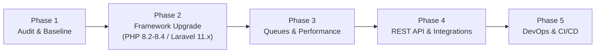

# Grow CRM — Strategic Development & Maintenance Plan

This document outlines the strategic roadmap, technical debt remediation, and modernization plan for **Grow CRM (v1.11)**.

---

## 1. Executive Summary

Grow CRM has a well-designed architecture featuring an Action-Domain-Responder (ADR) flow, repository pattern, and a custom declarative DOM AJAX engine (`NXAJAX`). However, because the core is built on **Laravel 8.x** and **PHP 7.4/8.0**, proactive maintenance is required to ensure long-term security, performance, and developer ergonomics.

### Core Objectives
1. **Security & Stability**: Modernize underlying framework dependencies to supported LTS versions.
2. **Performance**: Move from synchronous cron execution to true asynchronous queued workers.
3. **Maintainability**: Transition legacy schema scripts into standard Laravel migrations and establish test suites.
4. **Extensibility**: Build a standardized REST API (via Laravel Sanctum) to enable third-party integrations and headless clients.

---

## 2. Current State vs. Target State

| Dimension | Current State (v1.11) | Target State (Modernized) |
| :--- | :--- | :--- |
| **PHP Runtime** | PHP 7.2.5 – 8.0 | PHP 8.2 – 8.4 |
| **Framework** | Laravel 8.x (EOL) | Laravel 11.x (Latest Active) |
| **Asset Pipeline** | Webpack Mix (Legacy) | Vite 5.x |
| **Queue / Background** | Synchronous cron calls in scheduler | Asynchronous Laravel Queues (Redis / DB) |
| **Migrations** | Static `setup.sql` + `updating_*.php` | Versioned Laravel Migrations (`database/migrations`) |
| **API Authentication** | Basic API routes | Laravel Sanctum / Token-based REST API |
| **Deployment / Env** | Manual FTP / cPanel upload | Dockerized containers + CI/CD automated pipeline |

---

## 3. Phased Implementation Roadmap

---

### Phase 1: Stabilization, Baseline Audit & Testing (Weeks 1–2)

- [ ] **Dependency Vulnerability Audit**:
  - Run `composer audit` inside `/application` to identify security vulnerabilities in pinned packages.
  - Audit third-party JavaScript libraries in `/public/vendor/`.
- [ ] **Automated Test Harness**:
  - Initialize PHPUnit test cases (`tests/Feature` and `tests/Unit`).
  - Add smoke tests covering authentication, client creation, and invoice generation.
- [ ] **Code Quality & Linting**:
  - Introduce Laravel Pint or PHP-CS-Fixer configuration for PSR-12 standard enforcement.
- [ ] **Observability**:
  - Integrate error tracking (e.g. Sentry / Flare) into `app/Exceptions/Handler.php`.

---

### Phase 2: Framework Upgrade to Laravel 11.x (Completed)

- [x] **PHP 8.2 – 8.4 Compatibility Verification**:
  - Validated runtime on PHP 8.4.0.
  - Reconciled deprecated proxy headers in `config/trustedproxy.php`.
- [x] **Framework Upgrade to Laravel 11.x**:
  - Upgraded to `laravel/framework` v11.57.0.
  - Replaced `fideloper/proxy` with Laravel core's native `TrustProxies`.
  - Replaced abandoned `facade/ignition` with `spatie/laravel-ignition` (v2.12).
  - Replaced abandoned `fzaninotto/faker` with `fakerphp/faker` (v1.24).
  - Upgraded `nwidart/laravel-modules` to v11.1 and modernized command definitions in `config/modules.php`.
  - Upgraded `barryvdh/laravel-dompdf` to v3.1 and `barryvdh/laravel-debugbar` to v3.16.
  - Verified and cleared all 815 application routes cleanly.
- [ ] **Database Schema Standardization**:
  - Convert `setup.sql` table structures into standard Laravel migration files.
  - Package `application/updating/updating_*.php` into discrete database seeders/migrations.

---

### Phase 3: Background Queues & Performance Optimization (Weeks 7–9)

- [ ] **Queue Worker Migration**:
  - Convert `App\Cronjobs\EmailCron` and `EmailBillsCron` from synchronous scheduler calls into queued jobs dispatched via `Queue::push()`.
  - Configure database queue driver (`php artisan queue:work`) or Redis for high-throughput email and PDF generation.
- [ ] **Database Indexing & Query Tuning**:
  - Audit high-volume query joins in `App\Repositories\TaskRepository` and `ProjectRepository`.
  - Add composite indexes on `events` (`event_parent_type`, `event_parent_id`, `created_at`) and `tasks` (`task_projectid`, `task_status`).
- [ ] **Asset Bundling Modernization**:
  - Migrate from `webpack.mix.js` to modern Vite.
  - Minify and bundle core JS (`public/js/core/ajax.js`, `app.js`).

---

### Phase 4: REST API & Integration Ecosystem (Weeks 10–12)

- [ ] **Token Authentication**:
  - Install and configure `laravel/sanctum` for SPA and mobile API token authentication.
- [ ] **RESTful Endpoints**:
  - Expose versioned REST endpoints under `/api/v1/`:
    - `/api/v1/clients`
    - `/api/v1/projects`
    - `/api/v1/tasks`
    - `/api/v1/invoices`
  - Implement JSON API Resources (`App\Http\Resources\*`) decoupling response formatting from blade views.
- [ ] **Outgoing Webhook Engine**:
  - Trigger webhook events on entity state transitions (e.g. `invoice.paid`, `lead.created`, `task.completed`).

---

### Phase 5: Containerization & CI/CD Pipelines (Weeks 13–14)

- [ ] **Dockerization**:
  - Create `Dockerfile` tailored for PHP-FPM 8.2 with all required extensions (`gd`, `bcmath`, `pdo_mysql`, `zip`).
  - Create `docker-compose.yml` defining services: `app` (PHP-FPM), `web` (Nginx), `db` (MySQL 8), `queue` (artisan worker), and `redis` (cache & queues).
- [ ] **Automated CI/CD**:
  - Configure GitHub Actions pipeline:
    - Step 1: Lint checks (Pint / PHPCS).
    - Step 2: Automated tests execution (`php artisan test`).
    - Step 3: Build assets.
    - Step 4: Automated deployment to staging/production servers.

---

## 4. Priority Matrix

| Initiative | Impact | Effort | Priority | Target Milestone |
| :--- | :---: | :---: | :---: | :---: |
| Dependency Security Audit & Bugfixes | High | Low | **P0** | Phase 1 |
| PHP 8.2–8.4 Compatibility Refactoring | High | Medium | **P0** | Phase 2 |
| Sequential Upgrade to Laravel 11.x | Critical | High | **P1** | Phase 2 |
| Async Email & PDF Queueing | High | Medium | **P1** | Phase 3 |
| Database Index Optimization | Medium | Low | **P1** | Phase 3 |
| REST API Expansion (Sanctum) | High | Medium | **P2** | Phase 4 |
| Docker & CI/CD Automation | Medium | Medium | **P2** | Phase 5 |

---

## 5. Review & Governance

- **Weekly Checkpoint**: Review task progress against current milestone deliverables.
- **Breaking Change Gate**: Ensure all database modifications maintain backwards compatibility with existing customer databases.
- **Documentation Sync**: Update [README.md](README.md) and [architecture.md](architecture.md) whenever architectural changes or new commands are introduced.

